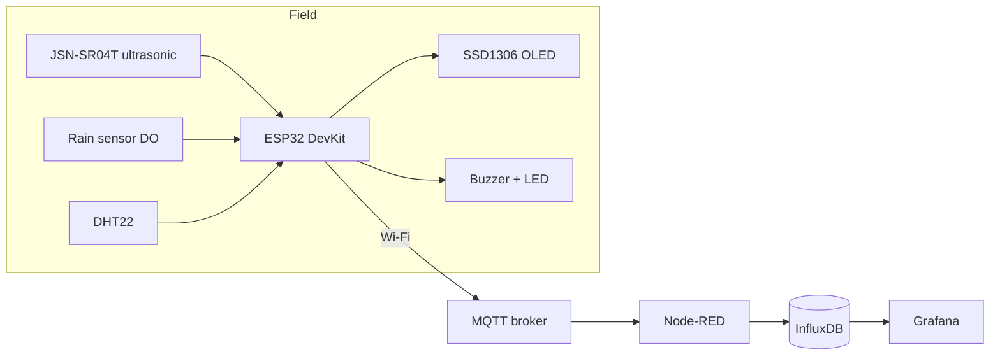

# FloodAlert-ESP32

<p align="center">
  <a href="https://github.com/zis3c/FloodAlert-ESP32/actions/workflows/ci.yml">
    
  </a>
  
  
  
  
</p>

End-to-end flood monitoring firmware for the ESP32. The device reads a
waterproof ultrasonic sensor, a rain sensor, and a DHT22, drives a local alarm
(buzzer and LED), shows live status on an SSD1306 OLED, and publishes JSON
telemetry over MQTT for Node-RED, InfluxDB, and Grafana.

The alert decision, rain debounce, and water-level math are isolated in a small
library and covered by native unit tests, so the safety logic is verified
without hardware.

## Features

| Area | Detail |
| --- | --- |
| Water level | JSN-SR04T ultrasonic, median of 5 samples, percent of tank depth |
| Rain detection | Digital rain sensor with a 3-read debounce |
| Environment | DHT22 temperature and humidity, 2.5 s update interval |
| Local feedback | SSD1306 128x64 OLED, active buzzer, status LED |
| Alarm logic | Latched water alert combined with rain state (hysteresis on entry/exit) |
| Connectivity | Wi-Fi auto-reconnect without blocking the sensor loop |
| Telemetry | MQTT JSON every 2.5 s, retained status topic, last-will `offline` |
| Reliability | Missing OLED or Wi-Fi does not stop the alarm path |
| Quality | Warning-free build (`-Wall -Wextra -Werror`), cppcheck, 6 native tests, CI |

## Architecture



The MQTT retention flow and dashboard setup are documented in
[`docs/mqtt_nodered_influx_grafana.md`](docs/mqtt_nodered_influx_grafana.md).

## Hardware

| Component | Quantity | Notes |
| --- | --- | --- |
| ESP32 DevKit (esp32dev) | 1 | 3.3 V logic |
| JSN-SR04T waterproof ultrasonic | 1 | 5 V supply, trigger/echo |
| Rain sensor module (DO output) | 1 | Active-low digital output |
| DHT22 / AM2302 | 1 | Temperature and humidity |
| SSD1306 128x64 I2C OLED | 1 | Address `0x3C` |
| Active buzzer | 1 | Drive through a transistor |
| LED + resistor | 1 | Local status indicator |

Pin mapping, wiring notes, and calibration steps are in
[`docs/hardware.md`](docs/hardware.md).

| Signal | GPIO | Mode |
| --- | --- | --- |
| Ultrasonic trigger | 5 | Output |
| Ultrasonic echo | 18 | Input |
| Rain sensor digital output | 27 | Input pull-up |
| DHT22 data | 4 | Input |
| Buzzer | 25 | Output |
| Status LED | 26 | Output |
| OLED SDA / SCL | 21 / 22 | I2C |

## Quick start

### Prerequisites

- Python 3 and PlatformIO Core (`pip install platformio`)
- ESP32 DevKit connected over USB
- 2.4 GHz Wi-Fi network
- MQTT broker reachable from the device

### Configure credentials

Credentials are injected at build time and never committed:

```powershell
$env:FLOOD_WIFI_SSID="your_wifi_name"
$env:FLOOD_WIFI_PASSWORD="your_wifi_password"
$env:FLOOD_MQTT_BROKER_HOST="192.168.1.10"
# Optional broker authentication
$env:FLOOD_MQTT_USERNAME="flood-device"
$env:FLOOD_MQTT_PASSWORD="your_broker_password"
```

On Linux/macOS use `export NAME=value` with the same variable names.

### Build, flash, monitor

```bash
pio run -e esp32dev
pio run -e esp32dev -t upload
pio device monitor -b 115200
```

`pio run` without flags builds the ESP32 firmware. The `native` environment is
reserved for unit tests.

### Tests and static analysis

```bash
pio test -e native
pio check -e esp32dev --fail-on-defect=low --skip-packages
```

The native tests require a host C++ compiler (`gcc`/`g++`). CI provides one.

## MQTT interface

### Topics

| Topic | Direction | Retained | Payload |
| --- | --- | --- | --- |
| `floodmonitor/telemetry` | device -> broker | No | JSON telemetry |
| `floodmonitor/debug` | device -> broker | No | Same JSON as telemetry |
| `floodmonitor/status` | device -> broker | Yes | `online`, `offline`, `ALERT`, `NORMAL` |
| `iot/flood/water_distance` | device -> broker | No | Distance in cm, 2 decimals |
| `iot/flood/rain_status` | device -> broker | No | `1` (rain) or `0` (dry) |
| `iot/flood/temperature_c` | device -> broker | No | Temperature, 2 decimals |
| `iot/flood/humidity_pct` | device -> broker | No | Humidity, 2 decimals |

The retained status topic also carries the last-will message `offline`, so a
consumer can detect a dead node. Note that it mixes connection state and alarm
state; see the security assessment for the implications.

### Payload

```json
{
  "distance_cm": 42.35,
  "water_level_percent": 57.6,
  "rain_detected": true,
  "temperature_c": 28.40,
  "humidity_percent": 81.20,
  "flood_alert": true,
  "alarm_active": true,
  "wifi_rssi": -58
}
```

`distance_cm` is `-1` when the sensor times out, temperature and humidity are
`-999` when the DHT22 read fails, and `alarm_active` is the latched flood alert
AND the debounced rain state.

## Security

The firmware supports optional broker authentication and a per-device MQTT
client ID derived from the MAC address. A local broker hardening example with
per-topic ACLs is provided in [`deploy/mosquitto/`](deploy/mosquitto/).

The full threat model, findings, accepted risks, and reproduction steps are in
[`docs/security.md`](docs/security.md). The short version: this is designed for
a trusted local network; do not expose the broker to the internet without TLS,
per-device credentials, and broker ACLs.

## Testing and CI

| Check | Command | What it proves |
| --- | --- | --- |
| Unit tests | `pio test -e native` | Water-level math, alert hysteresis, rain debounce |
| Firmware build | `pio run -e esp32dev` | Warning-free compile with `-Wall -Wextra -Werror` |
| Static analysis | `pio check -e esp32dev --fail-on-defect=low --skip-packages` | No cppcheck warnings, performance, or portability defects |

[`.github/workflows/ci.yml`](.github/workflows/ci.yml) runs all three on every
push to `main`, on pull requests, and on manual dispatch. Dependencies are
pinned for reproducible builds.

## Repository layout

```text
FloodAlert-ESP32/
├── .github/workflows/ci.yml       Tests, build, static analysis, artifact upload
├── deploy/mosquitto/
│   ├── mosquitto.conf             Local broker hardening example
│   └── acl                        Device publish, dashboard read-only
├── docs/
│   ├── architecture.md            Firmware structure and runtime behavior
│   ├── hardware.md                BOM, wiring, mounting, calibration
│   ├── operations.md              Deployment, verification, maintenance
│   ├── security.md                Threat model and findings
│   ├── mqtt_nodered_influx_grafana.md
│   ├── node_red_influx2_setup.md
│   ├── node_red_flow_example.json
│   └── node_red_influx2_flow.json
├── lib/flood_logic/
│   ├── flood_logic.h              Water level, alert latch, rain debounce API
│   └── flood_logic.cpp            Unit-tested logic implementation
├── src/main.cpp                   Firmware entry point and hardware I/O
├── test/test_flood_logic/
│   └── test_main.cpp              Unity tests for the native environment
├── CONTRIBUTING.md
├── LICENSE
├── README.md
├── SECURITY.md
└── platformio.ini                 ESP32 and native environments
```

`.pio/`, `compile_commands.json`, and generated `.vscode/*` files are build
artifacts and stay ignored. Credentials come from environment variables, not
from versioned files.

## Configuration

Runtime behavior is defined as compile-time constants in `src/main.cpp`:

| Constant | Value | Meaning |
| --- | --- | --- |
| `TANK_DEPTH_CM` | `100.0` | Sensor-to-bottom depth used for the percentage |
| `ALERT_ENTER_PERCENT` | `1.0` | Water level that latches the flood alert |
| `ALERT_EXIT_PERCENT` | `0.0` | Water level that clears the flood alert |
| `SENSOR_INTERVAL_MS` | `2500` | Sensor read period |
| `OLED_INTERVAL_MS` | `1000` | OLED refresh period |
| `SERIAL_INTERVAL_MS` | `10000` | Minimum serial status period |
| `HEARTBEAT_INTERVAL_MS` | `60000` | Serial heartbeat period |
| `MQTT_RETRY_MS` | `5000` | MQTT reconnect attempt period |
| `WIFI_RETRY_MS` | `15000` | Wi-Fi reconnect attempt period |
| `JSN_SAMPLES` | `5` | Ultrasonic samples per reading (median) |
| `RAIN_DEBOUNCE_COUNT` | `3` | Consecutive reads required to change rain state |

Change `TANK_DEPTH_CM` and the alert thresholds to match your installation.
The matching logic lives in `lib/flood_logic/` and is covered by tests.

## Troubleshooting

| Symptom | Check |
| --- | --- |
| No serial port | USB data cable, board driver, hold `BOOT` while flashing |
| `SSD1306 init failed` | OLED power, SDA 21, SCL 22, address `0x3C`; firmware continues without it |
| `Distance: ERR` | JSN-SR04T 5 V supply, trigger 5, echo 18, common ground |
| `Temp: ERR` / `Hum: ERR` | DHT22 data pin 4, pull-up resistor, sensor supply |
| `MQTT failed, rc=-2` | Broker host reachable, correct port 1883 |
| `MQTT failed, rc=4/5` | Broker username/password or ACL rejects the device |
| Wi-Fi keeps retrying | SSID/password correct, 2.4 GHz network, signal reach |
| Grafana has no data | Topic name, Node-RED flow, InfluxDB bucket and measurement |

## Documentation

- [Architecture and firmware reference](docs/architecture.md)
- [Hardware and calibration](docs/hardware.md)
- [Deployment and operations](docs/operations.md)
- [MQTT to Node-RED, InfluxDB, and Grafana](docs/mqtt_nodered_influx_grafana.md)
- [Node-RED InfluxDB 2 setup](docs/node_red_influx2_setup.md)
- [Security assessment](docs/security.md)
- [Security policy](SECURITY.md)
- [Contributing](CONTRIBUTING.md)

## License

MIT. See [LICENSE](LICENSE).
